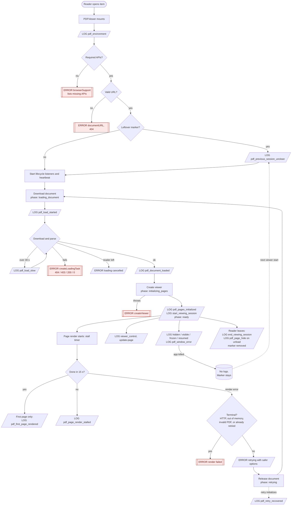
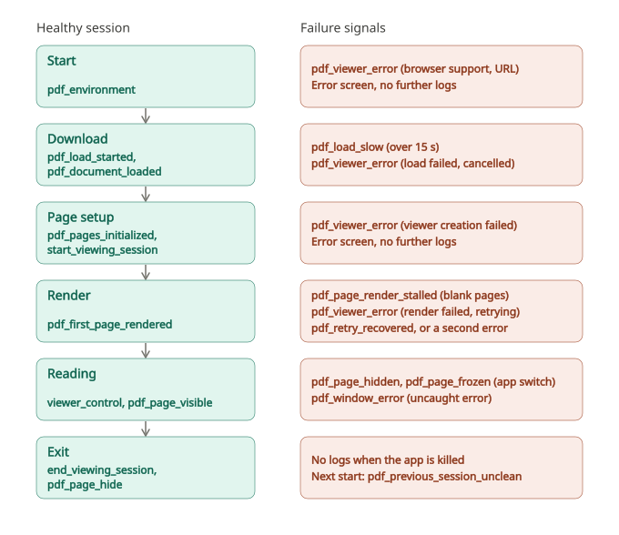

# Viewer logging

Readers on locked-down Android tablets report PDFs that load partially, go blank after the spinner stops, and crash when idle or when switching apps. This document lists the logs the PDF and page viewers send and how to follow one session.

All logs in a session share an `event_uuid`. Filter on it and order by `timestamp` to replay a session.

## Flow

Red nodes are error screens.

## Reading a session

The left column is what a healthy session logs at each stage. The right column is what a failure logs at that stage.

Two checks use the viewer fields:

- **Direct entry:** `start_viewing_session` with `viewer_type: page` and no earlier `viewer_mode_switch`.
- **Left a failing PDF viewer:** `viewer_mode_switch` with `viewer_type: pdf`, `to_viewer: page` and `viewer_had_problem: true`. `viewer_phase: failed` means it ended on an error screen.

Healthy order: `pdf_environment`, `pdf_load_started`, `pdf_document_loaded`, `pdf_pages_initialized`, `start_viewing_session`, `pdf_first_page_rendered`, controls, `end_viewing_session`.

| Sequence stops after                                      | Likely cause                                                                             |
| --------------------------------------------------------- | ---------------------------------------------------------------------------------------- |
| `pdf_environment`                                         | Unsupported browser (`missing_apis`) or worker setup failed. Look for `pdf_viewer_error` |
| `pdf_load_started` / `pdf_load_slow`                      | Download never finished. Compare `bytes_loaded` to `bytes_total` and connection fields   |
| `pdf_document_loaded`                                     | Page setup failed or page died. Check `pdf_window_error` and next session's unclean log  |
| `pdf_first_page_rendered`, then `pdf_page_render_stalled` | Blank pages. Compare `js_heap_used_mb` to `js_heap_limit_mb` and `device_memory_gb`      |
| `pdf_page_hidden`                                         | App-switch kill. Confirm with `previous_visibility: hidden`                              |
| Retry error, then `pdf_retry_recovered`                   | Fallback worked                                                                          |
| Retry error, then a second error                          | Fallback did not help                                                                    |

## Logs

| `action`                                                                            | Event type          | When                                                        | Extra fields                                                                                                                                                                     |
| ----------------------------------------------------------------------------------- | ------------------- | ----------------------------------------------------------- | -------------------------------------------------------------------------------------------------------------------------------------------------------------------------------- |
| `pdf_environment`                                                                   | `viewer_diagnostic` | Viewer starts, before support checks                        | Network, storage, worker, and decoder settings; `missing_apis`                                                                                                                   |
| `pdf_load_started`                                                                  | `viewer_diagnostic` | Each load attempt, including the retry                      | none                                                                                                                                                                             |
| `pdf_load_slow`                                                                     | `viewer_diagnostic` | Still downloading after 30 s                                | `waited_ms`                                                                                                                                                                      |
| `pdf_document_loaded`                                                               | `viewer_diagnostic` | Download and parse done                                     | `load_ms`, `num_pages`, `worker_is_real`                                                                                                                                         |
| `pdf_pages_initialized`                                                             | `viewer_diagnostic` | PDF.js created page views                                   | none                                                                                                                                                                             |
| `start_viewing_session`                                                             | same                | Pages initialized                                           | none                                                                                                                                                                             |
| `pdf_first_page_rendered`                                                           | `viewer_diagnostic` | First page drawn                                            | `page_number`, `render_ms`, `ms_since_load_start`                                                                                                                                |
| `pdf_page_render_stalled`                                                           | `viewer_diagnostic` | A page started rendering and did not finish in 15 s (max 5) | `page_number`, `stalled_ms`                                                                                                                                                      |
| `toggle-menu`, `rotate-*`, `zoom-*`, `fit-view`, `toggle-fullscreen`, `update-page` | `viewer_control`    | Reader uses a control                                       | none                                                                                                                                                                             |
| `pdf_page_hidden` / `pdf_page_visible`                                              | `viewer_diagnostic` | App switched away / back                                    | `hidden_for_ms` on return                                                                                                                                                        |
| `pdf_page_frozen` / `pdf_page_resumed`                                              | `viewer_diagnostic` | Browser froze / resumed the page                            | none                                                                                                                                                                             |
| `pdf_window_error`                                                                  | `viewer_diagnostic` | Uncaught error or rejection (max 5)                         | `error_message`, `error_source`, `error_line`                                                                                                                                    |
| `pdf_viewer_error`                                                                  | `error`             | Any viewer failure (support, URL, load, render, cleanup)    | `viewer_error`; unsupported browser lists missing APIs                                                                                                                           |
| `page_viewer_error`                                                                 | `error`             | Page viewer metadata or page image failure                  | `viewer_error` (`PageImagesUnavailable` when no page count), `current_page`, `total_pages`                                                                                       |
| `pdf_retry_recovered`                                                               | `viewer_diagnostic` | Retry with safer options initialized                        | none                                                                                                                                                                             |
| `viewer_mode_switch`                                                                | `link_click`        | Reader switches viewers, either direction                   | `to_viewer`, `destination`; leaving the PDF viewer adds `viewer_phase`, `viewer_had_problem`, and nested `had_error`, `stall_count`, `retried`, `ms_in_viewer`, `pages_rendered` |
| `pdf_page_hide`                                                                     | `viewer_diagnostic` | Page unloading                                              | `persisted`                                                                                                                                                                      |
| `end_viewing_session`                                                               | same                | Component unmounted                                         | none                                                                                                                                                                             |
| `pdf_previous_session_unclean`                                                      | `viewer_diagnostic` | A viewer starts and finds a leftover marker                 | `previous_*` state, `previous_visibility` (top-level), `ms_since_previous_beat`                                                                                                  |

### Fields on every viewer log

Top-level, so Elasticsearch can filter and aggregate them:

- `viewer_type` (`pdf` or `page`), `viewer_phase`, `viewer_visibility`, `js_heap_used_mb`, `device_memory_gb`, `chromium_major`, `connection_type`.
- Switch logs only: `to_viewer`, `viewer_had_problem`.
- Device fields repeat on every log because logs cannot be joined by session. Memory is missing on WebViews without `performance.memory`.
- Page viewer logs carry `viewer_type` and the device fields. Its control and error logs add `viewer_phase` (`loading_metadata`, `loading_page`, `ready`), `current_page` and `total_pages`.
- Each name fixes its indexed type on first write, so do not change a type once logs ship.

Inside `viewer_diagnostics` (not indexed, read per log line): `ms_since_mount`, `is_retry`, `bytes_loaded`, `bytes_total`, `pages_render_started`, `pages_rendered`, `js_heap_limit_mb`.

### Crash detection

The viewer writes a marker to `localStorage` (`pdfViewerSession`) every 10 s and on each phase, visibility, freeze, and resume change. A clean exit removes it. After a kill or crash the marker survives, and the next viewer logs `pdf_previous_session_unclean`.

- `previous_visibility: hidden`: died while backgrounded, likely an app-switch kill.
- `previous_visibility: visible` with high `previous_js_heap_used_mb`: crash while reading.
- `previous_phase`: where it died.
- Small `ms_since_previous_beat` with a still-open `event_uuid`: false positive from overlapping viewers.
- Tabs share one marker and the latest wins, so with several tabs open a crash can go unreported or a live tab can look unclean. Tablets run one tab.

Storage is checked once at viewer start. If it is blocked or discards writes, the viewer works normally but skips the marker and heartbeat, so it sends no unclean-session logs. Check `local_storage_available` in `pdf_environment`.

## Not covered

- `sendBeacon` return value is ignored, so oversized logs (viewer errors carry two stacks) could drop silently.
- Pages PDF.js reports as rendered but are blank.
- PDF.js console warnings and server range-request behavior.

## Backend requirement

The backend `FRONTEND_LOG_EVENTS` allowlist must include `viewer_diagnostic`, or the endpoint rejects the logs and the beacon hides it. Verify in staging that `event_uuid` and a numeric field such as `js_heap_used_mb` are filterable.
